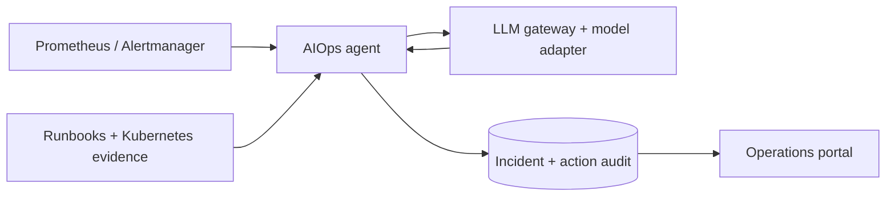
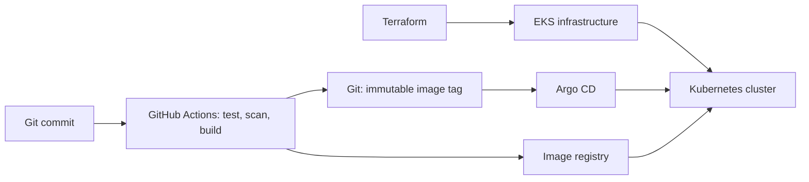

# AIOps DevOps Platform

A GitOps-managed platform that turns Kubernetes alerts into evidence-backed,
AI-assisted incident diagnoses and records any allow-listed remediation.

**Demo GIF:** not recorded yet; no live capture is being presented as evidence.

## What happens when a service fails?

Prometheus and Alertmanager deliver an alert to the AIOps agent. The agent
deduplicates repeat alerts, collects bounded pod-log and Kubernetes-event
evidence, retrieves a relevant runbook, and requests a diagnosis through the
LLM gateway and model adapter. It stores the incident and action audit for the
portal to display. The agent never executes model-generated commands.

The gateway authenticates internal calls, tracks provider-reported token use,
and enforces a daily token budget. On kind, the adapter uses a canned mock
provider by default, so a learner can deploy the stack without a paid LLM key.

## Architecture

**Incident flow**



**Delivery flow**



## Quick start: local demo

Requires Docker Compose v2, Git, GNU Make, and Bash. Start in the directory
where you want to clone the repository:

1. Clone the repository and open its root directory:

   ```bash
   git clone https://github.com/Ayush-Singh986/AI-Powered-Internal-Developer-Platform.git
   cd AI-Powered-Internal-Developer-Platform
   ```
2. Start the stack: `make demo`. This builds the services and starts the mock
   LLM provider; no external API key is needed.
3. Open the portal at <http://localhost:8501> and Grafana at
   <http://localhost:3000>. Grafana's local demo login is `admin` /
   `demo-only-password`. Compose binds published ports to `127.0.0.1` only.
4. Run automated checks with `make test`. The smoke test uses a separate
   temporary Compose project, so use `make demo-alert` to populate the demo
   stack's own incident feed.
5. Add a visible example incident: run `make demo-alert`, then refresh the
   portal. This sends a **synthetic Alertmanager alert** to the real agent
   endpoint; it does not stop or damage a service.
6. Stop the local stack with `make demo-down`.

On Windows, run the Bash commands below in Git Bash or WSL with Docker
Desktop integration enabled.

## Project components

| Component | What it does |
|---|---|
| Prometheus and Alertmanager | Scrape `/metrics`, group alerts, and send firing alerts to the agent's authenticated webhook. |
| Runbook retrieval (`services/rag`) | Searches bundled Markdown runbooks lexically; it does not use embeddings or a vector database. |
| Model adapter (`services/model-serving`) | Calls an OpenAI-compatible provider. It does not host model weights. On kind and in the local demo, it calls the canned mock provider. |
| LLM gateway | Authenticates internal requests, forwards completions, stores provider-reported token usage, and blocks requests after the configured UTC daily token budget. |
| AIOps agent | Deduplicates alerts, gathers bounded pod logs/events/deployment evidence, requests diagnosis, and records incidents and remediation attempts. |
| SQLite | Stores gateway token totals and agent incident/action history for this single-replica demo. |
| Operations portal | Displays service health, Grafana links, and the incident feed. It receives no provider API key. |
| Argo CD and Terraform | Argo CD reconciles Git-managed Kubernetes state. Terraform provisions the demo EKS infrastructure; it does not generate application findings. |

The diagnosis is advice, not an executable command. Remediation is disabled by
default; only an explicit allow-listed action can be attempted, the agent has
Kubernetes patch permissions only in the `rag` namespace, and action limits
and audit records are applied. The agent has read-only evidence access in the
monitored namespaces.

## Complete deployment walkthrough

### A. Run the application locally with Docker Compose

1. **Install tools.** Install Docker Desktop with Compose v2, Git, GNU Make,
   and Bash. Check that `docker compose version` and `make --version` work.
2. **Get the source.** Clone the AIOps platform repository using its confirmed
   GitHub URL and open the repository root in your Bash terminal. The exact
   clone URL is intentionally not guessed in this README.
3. **Build and start all services.** Run:

   ```bash
   make demo
   ```

   This invokes Docker Compose to build the service containers and starts the
   app with `services/mock-llm`. The mock returns a fixed response labelled
   `DEMO MODE: canned answer`; no provider account or API key is needed.
4. **Open the portal and dashboards.** Visit <http://localhost:8501> and
   <http://localhost:3000>. Grafana's local-only demo login is `admin` /
   `demo-only-password`. Compose publishes the application, Prometheus,
   Alertmanager, and Grafana ports only on `127.0.0.1`, not on the LAN.
5. **Create a sample incident.** Run:

   ```bash
   make demo-alert
   ```

   This sends a synthetic Alertmanager alert through the real agent endpoint.
   Refresh the portal to see the diagnosis and audit record. It does not stop
   or damage a service, so describe it as a demo alert, not a measured failure.
6. **Run checks.** Run:

   ```bash
   make test
   ```

   This runs unit tests for the services and the end-to-end Compose smoke
   test. The smoke test uses a separate temporary project and cleans up that
   project's containers and volumes; it does not populate the portal you
   opened in step 4.
7. **Stop the demo.** Run:

   ```bash
   make demo-down
   ```

### B. Deploy to local Kubernetes with kind and Argo CD

This deployment uses the mock LLM by default. It requires no paid model key.
It does require a GitHub repository that Argo CD can read and cluster-specific
sealed credentials for service authentication and Grafana.

1. **Install Kubernetes tools.** Install Docker, kind, kubectl, Kustomize, GNU
   Make, kubeseal, and Git. Confirm those commands are available in your Bash
   terminal. On Windows, use Git Bash or WSL with Docker Desktop integration.
2. **Clone the platform repository.** Use the confirmed GitHub clone URL,
   enter the repository directory, and create/push a branch that Argo CD can
   read. Public repositories work without additional Argo CD credentials.
   Private repositories require a configured SSH deploy key or repository
   token in Argo CD before bootstrap.
3. **Set the repository URL in GitOps manifests.** Replace the placeholders
   with the real repository owner and name:

   ```bash
   scripts/set-repo.sh OWNER/PLATFORM_REPO
   git add argocd
   git commit -m "chore: configure Argo CD repository"
   git push
   ```

   Push this one-time change first. Argo CD reads committed files from Git; it
   cannot use an uncommitted local URL. If `make kind-up` detects that these
   files still need updating, it will make the local edit, print instructions,
   and stop for this commit/push.
4. **Create cluster credentials.** In the same Bash session, enter a strong
   shared service token, action token, and Grafana password. The prompts hide
   the values; they are exported for the deployment command:

   ```bash
   read -r -s -p "Shared service token: " SERVICE_AUTH_TOKEN; printf '\n'; export SERVICE_AUTH_TOKEN
   read -r -s -p "Action approval token: " AIOPS_ACTION_TOKEN; printf '\n'; export AIOPS_ACTION_TOKEN
   read -r -s -p "Grafana password: " GRAFANA_ADMIN_PASSWORD; printf '\n'; export GRAFANA_ADMIN_PASSWORD
   ```

   Do not paste credentials into Git or command-line arguments. A provider
   key is not needed for this mock-backed kind deployment.
5. **Bootstrap kind, Argo CD, secrets, and images.** Run:

   ```bash
   make kind-up REPO=OWNER/PLATFORM_REPO
   ```

   The target checks/sets repository URLs, creates the `aiops-local` cluster,
   installs the pinned Argo CD `v3.5.6` release, applies the root Application,
   waits for Sealed Secrets, generates encrypted secrets, builds and loads the
   five service images plus the mock LLM image, and sets SHA-based tags in the
   kind overlays. The Sealed Secrets key is cluster-specific. Argo CD `v3.5.6`
   exists on the official [release page](https://github.com/argoproj/argo-cd/releases/tag/v3.5.6);
   this repository's manifests and installation have not yet been validated
   by a live cluster deployment.
6. **Commit the generated desired state once.** The helper does not commit or
   push changes for you. Review and push the sealed credentials and image
   overlays together:

   ```bash
   git add k8s/sealed-secrets/kind k8s/overlays/kind
   git commit -m "chore: prepare kind deployment"
   git push
   ```

   Commit only the generated SealedSecret resources. Never commit a plain
   Secret file, `.env`, or provider credential.
7. **Wait for GitOps reconciliation.** Argo CD installs the pinned
   infrastructure charts and services from Git. Check the Applications, pods,
   and ingress:

   ```bash
   kubectl get applications -n argocd
   kubectl get pods -A
   kubectl get ingress -A
   ```

   Wait until applications report Healthy and Synced. Only the portal and
   Grafana should have Ingress routes. Add `127.0.0.1 aiops.local` to the
   Windows hosts file to use <http://aiops.local> and
   <http://aiops.local/grafana>.
8. **Understand the network-policy limit.** The kind manifests contain
   NetworkPolicies, but kind's default CNI does not enforce them. The EKS
   Terraform code configures the VPC CNI network-policy option, but policy
   enforcement has not been tested on EKS either. Do not claim that isolation
   has been runtime-verified.
9. **Clean up the cluster.** When finished, delete the local cluster and its
   workloads:

   ```bash
   kind delete cluster --name aiops-local
   ```

#### Common kind deployment problems

| Error | Check |
|---|---|
| Argo CD cannot find or authenticate to the repository | Confirm `OWNER/PLATFORM_REPO`, that the repo URL change was pushed, and (for a private repo) Argo CD's deploy key/token. |
| A pod reports `ImagePullBackOff` | Confirm `make kind-up` loaded the image, the updated `k8s/overlays/kind/` tag was committed and pushed, and Argo CD synced it. |
| A pod reports `CreateContainerConfigError` or a SealedSecret does not decrypt | Confirm secrets were generated after this cluster's Sealed Secrets controller became available; regenerate after cluster recreation. |

### C. Deploy to AWS EKS

EKS provisions billable AWS resources. This is a demo deployment, not a
production-ready network or security configuration. Use the same GitHub
repository on branch `main` for Argo CD and GitHub Actions. The complete
Bash/PowerShell guide is in [docs/deployment.md](docs/deployment.md).

1. **Install tools and configure AWS access.** Install Terraform `>=1.10`,
   AWS CLI, kubectl, kubeseal, Git, GNU Make, and Bash. Configure AWS
   credentials with permission to create the Terraform resources, then verify
   the active account and identity:

   ```bash
   aws sts get-caller-identity
   ```

   Choose a region where the configured EKS Kubernetes version is supported.
   The example defaults to `us-east-1`, project `aiops-demo`, environment
   `demo`, and one `t3.medium` node.
2. **Create remote Terraform state.** Use a unique private S3 bucket for
   Terraform state; enable public-access blocking, versioning, and encryption.
   Example for `us-east-1`:

   ```bash
   export AWS_REGION=us-east-1
   export TF_STATE_BUCKET=replace-with-globally-unique-bucket-name
   aws s3api create-bucket --bucket "$TF_STATE_BUCKET" --region "$AWS_REGION"
   aws s3api put-public-access-block --bucket "$TF_STATE_BUCKET" \
     --public-access-block-configuration \
     BlockPublicAcls=true,IgnorePublicAcls=true,BlockPublicPolicy=true,RestrictPublicBuckets=true
   aws s3api put-bucket-versioning --bucket "$TF_STATE_BUCKET" \
     --versioning-configuration Status=Enabled
   aws s3api put-bucket-encryption --bucket "$TF_STATE_BUCKET" \
     --server-side-encryption-configuration \
     '{"Rules":[{"ApplyServerSideEncryptionByDefault":{"SSEAlgorithm":"AES256"}}]}'
   cp terraform/backend.hcl.example terraform/backend.hcl
   cp terraform/terraform.tfvars.example terraform/terraform.tfvars
   ```

   Edit `terraform/backend.hcl` to set the bucket and region. Edit
   `terraform/terraform.tfvars` to set the region, a currently supported
   `cluster_version`, and `cluster_endpoint_public_access_cidrs` to your
   operator's public IP in `/32` notation. Never use `0.0.0.0/0` for the
   Kubernetes API endpoint.
3. **Plan and create the infrastructure.** Run from the repository root.
   Review the plan and AWS costs before confirming `apply`:

   ```bash
   terraform -chdir=terraform init -backend-config=backend.hcl
   terraform -chdir=terraform validate
   terraform -chdir=terraform plan
   terraform -chdir=terraform apply
   ```

   Terraform creates the VPC, EKS cluster and node group, ECR repositories,
   and supporting IAM/add-on resources. The remote state bucket is separate
   and is not removed by `terraform destroy`.
4. **Allow GitHub Actions to publish images.** In AWS IAM, configure the
   GitHub Actions OIDC provider and a role restricted to this repository.
   Grant the role only the access needed for the Terraform plan/state and ECR
   image-publishing workflows; do not store long-lived AWS access keys in
   GitHub. In the repository's **Settings → Secrets and variables → Actions**,
   add:

   - Secret `AWS_TERRAFORM_ROLE_ARN`: the OIDC role ARN.
   - Variables `AWS_REGION` and `TF_STATE_BUCKET`: the values used above.
   - Variables `AWS_PROJECT_NAME` and `AWS_ENVIRONMENT`: the same values as
     `project_name` and `environment` in `terraform/terraform.tfvars`.
   - Variable `CLUSTER_ADMIN_CIDRS`: a Terraform list, for example
     `["203.0.113.10/32"]`, matching the operator CIDR in `terraform.tfvars`.

   The Terraform pull-request workflow also assumes this role. Because the
   role can publish images, only allow trusted pull requests in its OIDC trust
   policy; use a separate read-only role/workflow for untrusted pull requests.
   The image-publishing workflows assume the role on `main`.
5. **Point Argo CD at the repository.** Replace the repository placeholders,
   then commit and push this change before bootstrapping Argo CD:

   ```bash
   scripts/set-repo.sh Ayush-Singh986/AI-Powered-Internal-Developer-Platform
   git add argocd
   git commit -m "Configure Argo CD repository"
   git push
   ```

   Public repositories need no additional Argo CD credentials. For a private
   repository, configure a deploy key or repository token in Argo CD before
   installing the root Application.
6. **Build and publish the five service images.** In GitHub **Actions**, run
   each `Build ...` workflow on branch `main`: AIOps agent, LLM gateway,
   model serving, portal, and RAG. Each workflow tests and scans its service,
   pushes a commit-SHA-tagged image to ECR, and commits the image tag to
   `k8s/base/`. Wait for all five runs to pass before proceeding. These
   workflows support both pushes to service paths and manual dispatch.
7. **Connect to EKS and install Argo CD.** Get the cluster credentials and
   install the repository's pinned Argo CD release, then apply the root
   Application:

   ```bash
   cluster="$(terraform -chdir=terraform output -raw cluster_name)"
   region="$(terraform -chdir=terraform output -raw cluster_region)"
   aws eks update-kubeconfig --name "$cluster" --region "$region"
   aws sts get-caller-identity
   kubectl apply -f https://raw.githubusercontent.com/argoproj/argo-cd/v3.5.6/manifests/install.yaml
   kubectl -n argocd rollout status deployment/argocd-server --timeout=5m
   kubectl apply -f argocd/root-application.yaml
   ```

   Use the AWS identity that created the cluster, or grant the active
   identity access to the EKS cluster.
   Argo CD installs the infrastructure charts, including Sealed Secrets.
   Wait for its controller before creating application credentials:

   ```bash
   kubectl -n kube-system rollout status deployment/sealed-secrets-controller --timeout=5m
   ```
8. **Create EKS-encrypted credentials.** Enter strong tokens and your
   provider's API key in the shell without putting values in command history:

   ```bash
   read -r -s -p "Provider API key: " LLM_API_KEY; printf '\n'; export LLM_API_KEY
   read -r -s -p "Shared service token: " SERVICE_AUTH_TOKEN; printf '\n'; export SERVICE_AUTH_TOKEN
   read -r -s -p "Action approval token: " AIOPS_ACTION_TOKEN; printf '\n'; export AIOPS_ACTION_TOKEN
   read -r -s -p "Grafana password: " GRAFANA_ADMIN_PASSWORD; printf '\n'; export GRAFANA_ADMIN_PASSWORD
   scripts/seal-secrets.sh eks
   git add k8s/sealed-secrets/eks
   git commit -m "Add EKS sealed secrets"
   git push
   ```

   Commit only the generated SealedSecret YAML files. Never commit plaintext
   credentials. Sealed Secrets are tied to this EKS cluster and cannot be
   reused on kind or another cluster.
9. **Wait for deployment and configure access.** Confirm Argo CD applications
   are synced and healthy, and inspect pods and ingress:

   ```bash
   kubectl get applications -n argocd
   kubectl get pods -A
   kubectl get ingress -A
   kubectl get svc -n ingress-nginx
   ```

   The ingress controller provisions an AWS load balancer. The committed
   ingress host `aiops.local` is only a local demo name. Before exposing the
   application, configure DNS to the load balancer, update the portal host in
   `k8s/base/portal/ingress.yaml` and the Grafana host and `root_url` in
   `monitoring/kube-prometheus-values.yaml`, and configure TLS for both
   ingresses. Commit and push those changes for Argo CD to apply. Do not expose
   this demo over public HTTP.
10. **Tear down the demo.** When finished, destroy the billable resources and
    verify that EKS, EC2, load balancers, and EBS volumes are gone:

    ```bash
    make eks-destroy
    ```

    Terraform's S3 state bucket is retained; remove it separately only after
    you no longer need the state.

## Services

| Component | Purpose |
|---|---|
| Runbook retrieval (`services/rag`) | Deterministic keyword search over bundled Markdown runbooks; no embeddings or vector database. |
| Model adapter (`services/model-serving`) | Calls a configured OpenAI-compatible provider; it does not host model weights. |
| LLM gateway | Authenticates internal callers, routes requests, records provider-reported tokens, enforces a UTC daily token cap, and estimates cost only when both rates are configured. |
| AIOps agent | Deduplicates alerts, gathers bounded Kubernetes evidence, stores incidents, requests diagnosis, and applies an allow-list plus action-rate limit to any approved remediation. |
| Operations portal | Shows service health, Grafana access, and the real incident feed; demo responses are explicitly labeled canned. |

## Safety model

- Provider credentials and service/action tokens are runtime secrets. The
  repository contains a Sealed Secrets generation script, not plaintext keys
  or a made-up sealed ciphertext.
- Internal services currently share one service token. This is a known
  limitation: compromise of one service can expose calls to other internal
  routes; use separate per-service credentials before production.
- `/health` and `/metrics` remain open for probes and scraping. Model and
  gateway completion routes, runbook retrieval, the incident feed, and the
  Alertmanager webhook require bearer authentication.
- Kubernetes ingress exposes only the portal and Grafana. NetworkPolicy
  manifests are present, and Terraform configures the EKS VPC CNI network
  policy option, but enforcement has not been tested on either cluster. kind's
  default CNI does **not** enforce NetworkPolicies.
- Remediation is disabled by default. Only restart/scale actions are accepted,
  only `rag` has patch permissions, replica count is capped, and every
  action/refusal is timestamped. The agent has read-only evidence permissions
  in the monitored service namespaces.
- The gateway's daily token cap and the agent's LLM/action hourly caps are
  backed by SQLite. The gateway database is persisted in its own volume/PVC.

See [docs/security.md](docs/security.md) for implemented controls, automated
checks, and live checks that remain pending.

## Results

No live measurements have been collected in this environment. Do not copy
sample numbers into a resume. The raw-data file currently contains headers
only; add one row per trial after running the documented method.

| Measure | Current result | Method |
|---|---|---|
| Push-to-live | Not measured | Five pushes; time from push to Argo CD Healthy/Synced. |
| Service p95 latency | Not measured | Fixed workload of 100 requests, three repeated runs. |
| Cost per 1,000 requests | Not measured | Provider usage and current provider/model-specific rates; record pricing date. |
| Detect/fix time | Not measured | Same failure, five runs with and without agent assistance. |
| Resource stability | Not measured | Observe all pods under load for 30 minutes; record restarts and OOMs. |

Raw entries belong in [docs/results.csv](docs/results.csv); methods and
deployment-specific evidence are in [docs/deployment.md](docs/deployment.md).

## Why these tools

- **Argo CD instead of CI-driven `kubectl apply`:** CI tests, scans, and
  publishes immutable images; Argo CD reconciles committed desired state.
- **FastAPI:** small, independently testable HTTP services with health and
  Prometheus endpoints.
- **SQLite instead of Postgres:** easy local demo and one-replica incident
  history; replace it before horizontal scaling or production use.
- **Prometheus/Grafana:** scrape service and cluster metrics with a committed,
  provisioned dashboard.
- **Terraform:** reproducible demo AWS networking, EKS, ECR, and storage.

## Known limitations

- The demo provider is deterministic and is not suitable for measuring model
  quality, latency, or cost.
- Runbook search is lexical. The model adapter calls an external provider and
  does not support offline inference outside the canned kind/local demo.
- SQLite is not a multi-replica database. There is no user identity provider,
  production TLS policy, or external heartbeat receiver configured.
- The Sealed Secrets controller creates a different encryption key per
  cluster. kind and EKS each need their own sealed manifests; none can be
  produced or validated without access to the target cluster.
- Docker, kind, kubectl, Helm, and GNU Make are unavailable in this editing
  environment. `make demo`, `make test`, and cluster acceptance checks have
  therefore not been run here; do not publish them as passing.


## Next steps

1. Follow [docs/deployment.md](docs/deployment.md); run `make demo` and
   `make test` from a fresh clone on a machine with Docker.
2. Deploy kind with `make kind-up REPO=OWNER/PLATFORM_REPO`; verify the Argo
   applications and save real screenshots/GIFs under `docs/evidence/`.
3. Collect repeated measurements, update `docs/results.csv`, then finalize the
   resume bullet.

## License

Licensed under Apache-2.0. See [LICENSE](LICENSE).
