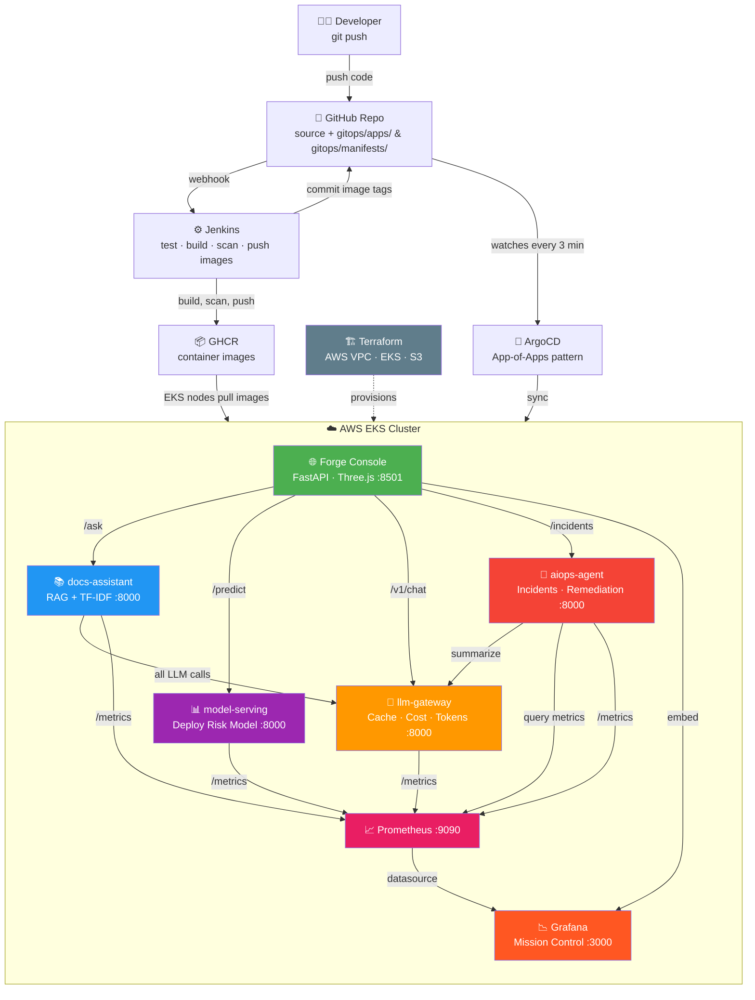
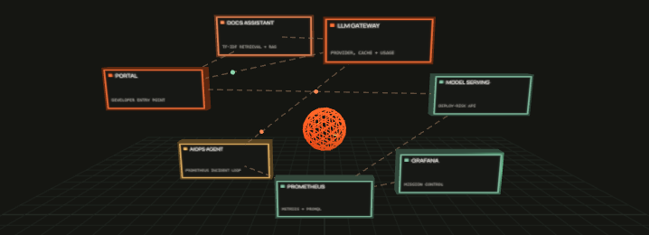

# AI-Powered Internal Developer Platform

[](https://www.python.org/downloads/release/python-3110/)
[](LICENSE)
[](https://argo-cd.readthedocs.io/)
[](https://www.terraform.io/)
[](https://www.docker.com/)

> An AI-powered Internal Developer Platform prototype designed for deployment to AWS EKS: documentation RAG, deployment-risk scoring, a shared LLM gateway, AIOps incident handling, and an operations console with environment health, workload logs, cost planning, and reports. Docker Compose and kind are optional local development paths, not the target deployment.

For a beginner-friendly explanation and interview Q&A, see [README_INTERVIEW.md](README_INTERVIEW.md).

---

## Architecture

```
Developer pushes code
       │
       ▼
┌─────────────────────────────┐       webhook       ┌────────────────────────────┐
│ GitHub repository           │────────────────────▶│ Jenkins CI                  │
│ source + GitOps manifests   │◀────────────────────│ test · build · scan         │
│ gitops/apps + manifests     │ commit image tags   │ push images to GHCR          │
└──────────────┬──────────────┘                     └─────────────┬──────────────┘
               │ Argo CD watches                                  │ push images
               ▼                                                  ▼
         ┌────────────┐                                      ┌────────────┐
         │  Argo CD   │                                      │    GHCR    │
         └─────┬──────┘                                      └──────┬─────┘
               │ sync manifests                                     │ pull images
               └──────────────────────────┬─────────────────────────┘
                                          ▼
                 ┌────────────────────────────────────────────┐
                 │ AWS EKS                                     │
                 │ Portal · docs-assistant · model-serving     │
                 │ llm-gateway · aiops-agent                   │
                 │ Prometheus · Grafana Mission Control        │
                 └────────────────────────────────────────────┘
                                          ▲
                 Terraform provisions AWS VPC, EKS, and S3
```

### Interactive Mermaid Diagram

For a very simple, step-by-step explanation of this diagram, see [The Architecture Diagram, in Simple English](README_DIAGRAM.md).



### 3D Platform Architecture

The console renders this topology interactively with Three.js. Drag the scene to orbit it and select a service node for a short description.



### How the Platform Works, From Start to Finish

This project is an internal developer platform (IDP): a set of shared tools that gives engineers one place to understand services, check a release, search internal guidance, and inspect operational signals. The architecture has two connected paths: a **delivery path** that builds and deploys software, and a **runtime path** that serves developer requests and reports health.

#### 1. A code change enters the delivery path

A developer pushes a change to GitHub. Jenkins runs the project checks and builds the portal's browser assets. On `main`, it also builds and scans the service images, pushes them to GHCR, and updates the GitOps manifests. This is the continuous integration (CI) part: it checks that a change is ready to package. CI is not the cluster controller and does not directly keep the live system reconciled.

#### 2. Terraform provides the infrastructure

Terraform describes the AWS foundation for the target deployment: a VPC and networking, an EKS Kubernetes cluster, and an S3 bucket for artifacts. Applying Terraform creates or updates that infrastructure; it does not deploy each application service. Docker Compose and kind are optional local development tools, not the target hosting environment.

#### 3. GitOps describes what Kubernetes should run

Kubernetes manifests in `gitops/manifests/` describe Deployments, Services, configuration, and monitoring integration. Argo CD starts from the root App-of-Apps definition in `gitops/bootstrap/root.yaml`, discovers the applications in `gitops/apps/`, and watches their desired configuration. When Git changes, Argo CD synchronizes the cluster toward that declared state. This separation makes Git the reviewable record of the intended deployment and Kubernetes the place where workloads run.

#### 4. The portal is the developer entry point

An engineer opens the Forge console. Its FastAPI backend exposes the browser-facing API, while the Vite-built JavaScript interface renders the operations console and its Three.js topology. The portal calls the platform services over HTTP; it is not the model, documentation index, or LLM provider itself. The environment selector chooses which configured service endpoints the portal queries. Only Development is configured by default, so other environments remain visibly disconnected until real endpoints are supplied.

#### 5. Requests are routed to the service that owns the work

- **Documentation question:** The portal sends a question to `docs-assistant`. The service searches its Markdown runbooks with TF-IDF, selects relevant sections, and returns the answer with source information. When configured, it can send retrieved context to `llm-gateway` to synthesize the response; retrieval/fallback behavior is available when model synthesis is not used.
- **Deployment risk check:** The portal sends release inputs, such as files changed, test coverage, and recent failures, to `model-serving`. The scikit-learn model returns a risk score and category. The current model uses synthetic training data, so this demonstrates the serving contract and is not a trustworthy production release gate.
- **AI chat:** The portal sends chat prompts to `llm-gateway`, which is the shared boundary for model-provider calls. The gateway supports mock responses for local use and a configured provider for real inference; it also centralizes response caching and records token, latency, and estimated-cost data. The documentation assistant and AIOps agent can use this same gateway instead of implementing separate provider integrations.
- **Incident activity:** The portal reads incident data from `aiops-agent`. The agent periodically queries Prometheus for configured signals and records incidents when its rules detect a problem. Remediation is opt-in; when enabled, the configured action can restart a workload, but restarting is not the same as safely rolling back a bad release.
- **Workloads and logs:** The portal can show container inventory and recent logs only when the optional operations integration is configured and authorized. This is read-only access, gated by an operations token in the demo; Kubernetes deployments should retain narrowly scoped namespace permissions and use real user authentication before exposure.

#### 6. Telemetry closes the operations loop

The four application services expose Prometheus metrics such as request volume and latency, LLM usage and estimated spend, model predictions, and incident actions. Prometheus scrapes those endpoints and makes the time-series data queryable. Grafana reads Prometheus and presents the Mission Control dashboard. The portal can also link to or embed the dashboard, while its own health view calls service health endpoints and displays the latest check results. In this way, requests create operational signals, and those signals feed both human dashboards and the AIOps incident loop.

#### 7. The console helps with planning and reporting

The cost planner recalculates an illustrative infrastructure estimate from the selected resource assumptions; it is not connected to AWS billing or live pricing. A generated report captures a point-in-time environment and incident snapshot together with the planner inputs. These features help an engineer reason about a proposed setup, but they should not be mistaken for billing data or a compliance record.

#### The complete lifecycle

In short: **a developer changes code → CI checks and packages it → Terraform supplies the cluster foundation → Git records the Kubernetes desired state → Argo CD synchronizes that state → the portal routes user requests to focused services → Prometheus collects runtime metrics → Grafana and AIOps turn those metrics into visibility and incident signals.** A developer can then use the same portal to inspect health, ask questions, evaluate a proposed deployment, and review an operational snapshot.

This is a learning and demonstration platform, not a ready-made production control plane. Before production use, replace synthetic model training data and illustrative pricing, configure real identity and secret management, review service/network permissions, and validate remediation and deployment rollback procedures.

---

## Services

| Service | What it does | Port | Key Tech |
|---|---|---|---|
| `portal` | Forge operations console: environment health, workloads/logs, risk scoring, AI chat, cost planning, and reports | 8501 | FastAPI, Vite, Three.js |
| `docs-assistant` | RAG over runbooks, answers via LLM gateway | 8000 | FastAPI, TF-IDF, sklearn |
| `model-serving` | Deploy-risk prediction (synthetic training data) | 8000 | FastAPI, scikit-learn |
| `llm-gateway` | Single door to LLM: cache, token count, cost | 8000 | FastAPI, httpx |
| `aiops-agent` | Watches Prometheus, opens incidents, restarts deployments (opt-in) | 8000 | FastAPI, asyncio |
| `prometheus` | Scrapes `/metrics` from all 4 services | 9090 | Prometheus |
| `grafana` | Mission Control dashboard | 3000 | Grafana |

---

## Optional Local Development — Run with Docker Compose (5 minutes)

> This starts a local development copy only. The deployment target is AWS EKS. **Pre-requisites:** Docker Desktop running, `docker compose` v2, ~4 GB RAM free.

```bash
# 1. Clone
git clone https://github.com/your-org/ai-idp.git
cd ai-idp

# 2. Start everything (builds all images, starts 7 containers)
docker compose up --build

# 3. Open the UI
#   Portal       →  http://localhost:8501
#   Grafana      →  http://localhost:3000  (anonymous admin, no password)
#   Prometheus   →  http://localhost:9090
```

> LLM is **mocked by default** — no API key needed. For real Anthropic responses:
> ```bash
> LLM_PROVIDER=anthropic ANTHROPIC_API_KEY=sk-ant-... docker compose up --build
> ```

### What to try in the Forge Console (http://localhost:8501)

| Section | What to do |
|---|---|
| **Environment health** | Switch among configured profiles and inspect live `/healthz` checks and incident activity. Unconfigured environments are marked clearly. |
| **Knowledge search** | Search runbooks and service docs through the TF-IDF RAG service and inspect returned source names/relevance. |
| **Deploy risk** | Submit release inputs to the model-serving API. The model is trained on synthetic data; treat the score as a demo only. |
| **Workloads & logs** | Unlock token-gated, read-only container inventory/logs. Local Docker access is optional; Kubernetes access uses namespaced pod/log RBAC. |
| **AI copilot** | Chat through the LLM gateway. Mock mode works without an API key; Anthropic requires a configured key. |
| **Cost planner** | Change AWS resource and container assumptions to recalculate an illustrative monthly estimate and optimization checks. |
| **Reports** | Generate a point-in-time JSON snapshot or use the browser print dialog to save a PDF. |

The default Compose setup configures **Development only**. Staging and Production remain visibly disconnected until their API URLs are supplied with `IDP_ENVIRONMENTS`; the console never invents health data for them.

Configure all three profiles by setting the portal's `IDP_ENVIRONMENTS` variable to service base URLs reachable from the portal container. Example PowerShell value:

```powershell
$env:IDP_ENVIRONMENTS = @'
{"dev":{"services":{"docs":"http://docs-assistant:8000","model":"http://model-serving:8000","gateway":"http://llm-gateway:8000","aiops":"http://aiops-agent:8000"}},"staging":{"services":{"docs":"https://docs.staging.example.com","model":"https://model.staging.example.com","gateway":"https://gateway.staging.example.com","aiops":"https://aiops.staging.example.com"}},"production":{"services":{"docs":"https://docs.example.com","model":"https://model.example.com","gateway":"https://gateway.example.com","aiops":"https://aiops.example.com"}}}
'@
docker compose up --build
```

Replace the example URLs with real authenticated/reachable service endpoints. For Kubernetes pod inventory/logs, add a `namespaces` map to each profile and deploy the portal into the cluster whose API it should query. The checked-in Kubernetes manifest configures only `dev`; for separate staging and production clusters, deploy a portal per cluster rather than handing one console broad cross-cluster credentials.

To enable local container inventory and logs, start the optional read-only Docker socket proxy. In PowerShell:

```powershell
$env:COMPOSE_PROJECT_NAME = "ai-idp"
$env:DOCKER_API_URL = "http://docker-socket-proxy:2375"
$env:OPS_API_TOKEN = [guid]::NewGuid().ToString("N")
docker compose --profile ops up --build
```

Enter the generated token in **Workloads & logs**. The proxy is not exposed on a host port and disallows write requests, but Docker logs can contain secrets; use this profile only on a trusted local machine. Kubernetes pod logs use a namespaced read-only ServiceAccount and the same token gate.

For local development without containers, install the portal dependencies and build the static console before running Uvicorn:

```powershell
python -m pip install -r services/portal/requirements.txt
Push-Location services/portal/web
npm ci
npm run build
Pop-Location
Push-Location services/portal
python -m uvicorn app:app --host 127.0.0.1 --port 8501
```

The console is available at `http://localhost:8501`. For live backend calls, set `DOCS_URL`, `MODEL_URL`, `GATEWAY_URL`, and `AIOPS_URL` to reachable service endpoints before starting the portal. The cost planner uses illustrative rates, not AWS account billing or a live pricing feed.

### Stop

```bash
docker compose down -v       # stops and removes containers + volumes
```

---

## Project Structure

```
ai-idp/
├── Jenkinsfile                    # test → build/scan/push images → GitOps tag update
├── deploy/
│   └── local/
│       ├── prometheus.yml         # scrape all 4 services
│       ├── grafana-datasource.yml
│       └── grafana-dashboards.yml
├── gitops/
│   ├── bootstrap/root.yaml        # ArgoCD App-of-Apps
│   ├── apps/                      # one ArgoCD Application per service
│   └── manifests/                 # Kubernetes Deployment + Service + Kustomize
│       ├── docs-assistant/
│       ├── model-serving/
│       ├── llm-gateway/
│       ├── aiops-agent/
│       ├── portal/                 # console, ServiceAccount, scoped pod/log RBAC
│       └── mission-control/       # Grafana dashboard ConfigMap
├── services/
│   ├── common/observability.py    # shared Prometheus middleware
│   ├── docs-assistant/
│   ├── model-serving/
│   ├── llm-gateway/
│   ├── aiops-agent/
│   └── portal/                    # FastAPI API + Vite/Three.js console
│       └── web/                   # browser UI source and npm lockfile
├── terraform/
│   ├── envs/dev/main.tf
│   └── modules/{cluster,network,storage}/
├── tests/
│   ├── conftest.py
│   ├── test_services.py
│   └── test_portal.py
├── docker-compose.yml
├── Makefile
└── requirements-dev.txt
```

---

## Production Deployment — Step by Step

### Prerequisites

| Tool | Version | Install |
|---|---|---|
| `aws` CLI | latest | [aws.amazon.com/cli](https://aws.amazon.com/cli/) |
| `terraform` | ≥ 1.6 | [developer.hashicorp.com/terraform](https://developer.hashicorp.com/terraform/install) |
| `kubectl` | ≥ 1.29 | [kubernetes.io/docs](https://kubernetes.io/docs/tasks/tools/) |
| `helm` | ≥ 3.14 | [helm.sh](https://helm.sh/docs/intro/install/) |
| `argocd` CLI | ≥ 2.11 | [argo-cd.readthedocs.io](https://argo-cd.readthedocs.io/en/stable/cli_installation/) |
| Docker / `docker buildx` | latest | [docs.docker.com](https://docs.docker.com/engine/install/) |
| `gh` CLI (optional) | latest | [cli.github.com](https://cli.github.com/) |

---

### Step 1 — Fork & Configure the Repo

```bash
# Fork on GitHub, then clone your fork
git clone https://github.com/<YOUR_ORG>/ai-idp.git
cd ai-idp

# Replace placeholder org/repo references (one-liner)
find gitops/ -name "*.yaml" | xargs sed -i 's|your-org/ai-idp|<YOUR_ORG>/ai-idp|g'
find gitops/ -name "*.yaml" | xargs sed -i 's|ghcr.io/your-org|ghcr.io/<YOUR_ORG>|g'
```

---

### Step 2 — Provision Cloud Infrastructure with Terraform

```bash
# Authenticate with an AWS identity that can create VPC, EKS, IAM, and S3 resources
aws configure
aws sts get-caller-identity

cd terraform/envs/dev
terraform init
terraform plan -out=tfplan -var="artifact_bucket=<globally-unique-bucket-name>"
terraform apply tfplan
```

This creates:
- **AWS EKS cluster** (`idp-dev`) in `ap-south-1`, with a managed node group
- **VPC and private subnets** used by the EKS cluster
- **S3 bucket** named by `artifact_bucket` for platform artifacts

The application workloads run in AWS EKS. Terraform and `kubectl` commands may be launched from an administrator workstation or cloud shell, but they operate on AWS resources; Docker Compose and kind are optional local development tools only.

> **Cost warning:** EKS control-plane, EC2 worker, NAT, load-balancer, and storage charges apply. Review the plan and AWS pricing before applying. The current Terraform backend is local; configure a protected remote S3 backend and state locking before a shared deployment.

```bash
# Configure kubectl to talk to the new cluster
aws eks update-kubeconfig --name idp-dev --region ap-south-1
kubectl get nodes   # should show ready nodes
```

---

### Step 3 — Build & Push Docker Images

```bash
# Login to GitHub Container Registry
echo $GITHUB_TOKEN | docker login ghcr.io -u <YOUR_GITHUB_USER> --password-stdin

# Build and push all 5 images (replace TAG with git sha or semver)
export TAG=$(git rev-parse --short HEAD)

for svc in docs-assistant model-serving llm-gateway aiops-agent portal; do
  docker buildx build \
    --platform linux/amd64 \
    --file services/$svc/Dockerfile \
    --tag ghcr.io/<YOUR_ORG>/idp-$svc:$TAG \
    --push \
    .
done
```

---

### Step 4 — Update Kubernetes Manifests with New Image Tag

```bash
# Update kustomization.yaml image tags in gitops/manifests/
for svc in docs-assistant model-serving llm-gateway aiops-agent portal; do
  sed -i "s|newTag: .*|newTag: $TAG|" gitops/manifests/$svc/kustomization.yaml
done

git add gitops/
git commit -m "chore: deploy $TAG"
git push
```

---

### Step 5 — Install ArgoCD

```bash
kubectl create namespace argocd
kubectl apply -n argocd \
  -f https://raw.githubusercontent.com/argoproj/argo-cd/stable/manifests/install.yaml

# Wait for ArgoCD server
kubectl -n argocd rollout status deploy/argocd-server --timeout=300s

# Get the initial admin password
kubectl -n argocd get secret argocd-initial-admin-secret \
  -o jsonpath="{.data.password}" | base64 -d; echo
```

---

### Step 6 — Bootstrap the App-of-Apps

```bash
# Apply the root application — ArgoCD will pick up all services from gitops/apps/
kubectl apply -f gitops/bootstrap/root.yaml

# Port-forward ArgoCD UI (open http://localhost:8080, login admin / password from step 5)
kubectl -n argocd port-forward svc/argocd-server 8080:443
```

ArgoCD will now automatically sync all services whenever you push to `main`.

---

### Step 7 — Create Namespaces & Secrets

```bash
# Create one namespace per service
for ns in docs-assistant model-serving llm-gateway aiops-agent portal monitoring; do
  kubectl create namespace $ns --dry-run=client -o yaml | kubectl apply -f -
done

# LLM API key (required for real LLM responses, skip for mock mode)
kubectl -n llm-gateway create secret generic llm-gateway-secrets \
  --from-literal=ANTHROPIC_API_KEY="$ANTHROPIC_API_KEY" \
  --dry-run=client -o yaml | kubectl apply -f -

# Optional: unlock read-only workload inventory and pod logs in the console
export OPS_API_TOKEN="$(openssl rand -hex 32)"
kubectl -n portal create secret generic platform-ops-access \
  --from-literal=token="$OPS_API_TOKEN" --dry-run=client -o yaml | kubectl apply -f -
```

The ops token is a shared access gate, not user authentication. Put the console behind SSO and TLS before exposing it outside a trusted network.

---

### Step 8 — Install Prometheus + Grafana (kube-prometheus-stack)

```bash
helm repo add prometheus-community https://prometheus-community.github.io/helm-charts
helm repo update

helm upgrade --install kube-prometheus-stack prometheus-community/kube-prometheus-stack \
  --namespace monitoring --create-namespace \
  --set grafana.adminPassword="$GRAFANA_ADMIN_PASSWORD" \
  --set prometheus.prometheusSpec.serviceMonitorSelectorNilUsesHelmValues=false \
  --wait
```

Then apply the Mission Control dashboard ConfigMap:
```bash
kubectl apply -f gitops/manifests/mission-control/configmap.yaml
```

---

### Step 9 — Verify All Services Are Running

```bash
# Check ArgoCD sync status
argocd app list

# Check pod health per namespace
for ns in docs-assistant model-serving llm-gateway aiops-agent portal; do
  echo "=== $ns ==="
  kubectl -n $ns get pods
done

# Smoke test each service health endpoint
for ns in docs-assistant model-serving llm-gateway aiops-agent; do
  POD=$(kubectl -n $ns get pods -o jsonpath='{.items[0].metadata.name}')
  kubectl -n $ns exec $POD -- curl -sf http://localhost:8000/healthz
done
```

---

### Step 10 — Access the Platform

```bash
# Temporary access from your workstation to the remote AWS EKS cluster:
kubectl -n portal port-forward svc/portal 8501:8501
# Open http://localhost:8501

# For ongoing AWS access, configure a DNS name, TLS, and an access-controlled
# ingress/load balancer. The example ingress manifest uses the placeholder host
# idp.local and does not provision AWS ingress infrastructure by itself.

# Grafana
kubectl -n monitoring port-forward svc/kube-prometheus-stack-grafana 3000:80
# This also tunnels from your workstation to the AWS EKS cluster.
# Open http://localhost:3000
```

---

### Step 11 — Set Up CI/CD (Jenkins)

Create a Jenkins Multibranch Pipeline for this GitHub repository and configure a GitHub webhook (or periodic branch indexing) so pushes and pull requests trigger builds. The repository's `Jenkinsfile` runs tests on branches and pull requests. On `main`, it also builds and pushes five service images to GHCR, runs a report-only Trivy scan, updates the image namespace and tags in the GitOps manifests, and pushes that commit back to `main`. The `[skip ci]` marker on generated manifest commits prevents a build loop. ArgoCD then reconciles the updated manifests to the AWS EKS cluster; Jenkins does not directly deploy to Kubernetes or run Terraform. Terraform provisions the AWS runtime infrastructure. The Jenkins controller/agent hosting is not provisioned by this repository's Terraform.

The Jenkins agent must be Linux and needs Git, Python 3.12, Node.js 22 with npm, Docker CLI access to a running daemon, and Trivy. Install Jenkins Pipeline, Git, GitHub Branch Source, and Credentials Binding plugins; configure the Git installation as `Default` for the Git push credential binding.

Create these Jenkins credentials:

| Credential ID | Kind | Value |
|---|---|---|
| `ghcr-credentials` | Username with password | GitHub username and a token with permission to write GHCR packages |
| `github-push-credentials` | Username with password | GitHub username and a token with permission to push commits to this repository |

Set the `IMAGE_NAMESPACE` build parameter to the lowercase GitHub username or organization that owns the GHCR packages. Keep both tokens in Jenkins Credentials; do not add them to the repository. The pipeline does not run Terraform or deploy directly to AWS.

---

### Step 12 — Tear Down (When Done)

```bash
# Remove ArgoCD apps (triggers deletion of all k8s resources)
kubectl delete -f gitops/bootstrap/root.yaml

# Destroy cloud infra
cd terraform/envs/dev
terraform destroy -var="artifact_bucket=<globally-unique-bucket-name>"
```

---

## Makefile Reference

```bash
make up           # optional local Docker Compose development
make down         # stop the local Docker Compose stack
make test         # pip install dev deps + pytest
make kind-up      # local k8s cluster + ArgoCD bootstrap (requires kind)
make tf-plan      # terraform init + plan in envs/dev
```

---

## Observability

All four services expose `GET /metrics` in Prometheus text format via the shared `common/observability.py` middleware.

### Key Metrics

| Metric | Service | What it tracks |
|---|---|---|
| `http_requests_total` | all | Request count by service, method, path, status |
| `http_request_duration_seconds` | all | Latency histogram |
| `llm_requests_total` | llm-gateway | LLM calls by provider, cache hit/miss, caller |
| `llm_cost_usd_total` | llm-gateway | Estimated USD spend by caller |
| `llm_tokens_total` | llm-gateway | Input + output tokens |
| `llm_provider_latency_seconds` | llm-gateway | Provider call latency |
| `predictions_total` | model-serving | Predictions by risk level (low/medium/high) |
| `docs_answers_total` | docs-assistant | Answers by source (llm/fallback/no_match) |
| `aiops_incidents_total` | aiops-agent | Incidents by rule + action |

### Grafana Mission Control

Open [http://localhost:3000](http://localhost:3000) → **IDP Mission Control** dashboard.

Panels include: request rate per service, P95 latency, LLM token usage, LLM cost/hour, prediction count by risk level, active incidents.

---

## Known Limits (Read Before an Interview)

- **Model trained on synthetic data.** Proves the serving path, not prediction quality. Say this first.
- **Retrieval is TF-IDF**, not embeddings. It sometimes ranks the wrong chunk first. Next step: embeddings + vector store + eval set.
- **LLM prices are placeholders.** Set `PRICE_IN_PER_MTOK` / `PRICE_OUT_PER_MTOK` env vars to real values.
- **Gateway cache is in-memory, per pod.** Use Redis for multi-replica deployments.
- **Remediation is off by default.** `ENABLE_REMEDIATION=true` enables restarts. Rollback (not restart) is the real fix and is not automated here.
- **No user identity/SSO or network policies.** The shared ops token only gates read-only workload routes; it is not a login system. Put the console behind SSO/TLS and use managed secrets before exposing it.
- **Only Development is configured by default.** Supply real service URLs and namespace mappings before enabling Staging or Production in the selector.
- **Cost planner is illustrative.** It does not read AWS billing or live regional pricing; validate estimates against Cost Explorer and the AWS Pricing API.

---

## Resume Bullet

> Architected and shipped an AI-powered Internal Developer Platform unifying RAG search, MLOps model serving, fine-tuned LLM inference, and an autonomous AIOps remediation agent — deployed via GitOps (ArgoCD) on Kubernetes with unified cost and latency observability.

---

## License

MIT
