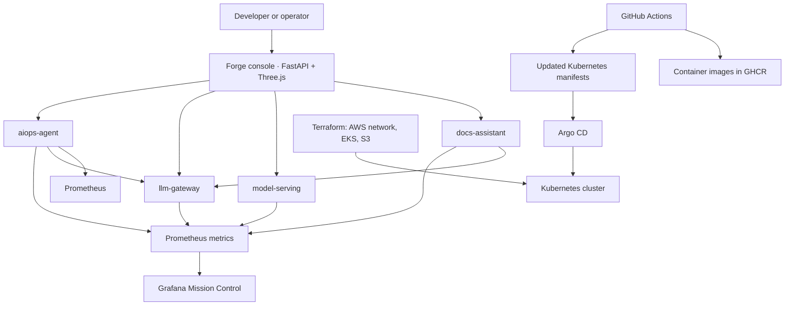

# AI Internal Developer Platform: End-to-End Project Walkthrough

This guide explains the project from the problem it addresses through its architecture, user flows, deployment, and operational limits. It is written so a newer engineer can understand the system and explain it clearly in an interview.

> **Be accurate in interviews:** This repository is a working platform prototype and learning project, not a claim that every component is production-ready. In particular, the deploy-risk model uses synthetic data, document retrieval uses TF-IDF rather than embeddings, LLM prices are configurable estimates, and AIOps remediation is disabled by default.

## 1. The Problem

As engineering organizations grow, developers often need to visit different tools and teams to get routine work done. They may search runbooks in one place, ask an operations engineer about a deployment in another, use a separate model or AI service, and check dashboards somewhere else. This creates friction and makes common tasks inconsistent.

Operations teams face a related problem: service health, latency, AI usage and incidents are spread across different metrics and workflows. Responding to an alert can require manually finding context, identifying the affected service, and deciding what to do next.

The project brings several common developer-platform capabilities behind one interface:

- Find answers in internal Markdown runbooks and service documentation.
- Estimate the risk of a proposed deployment using release-related inputs.
- Route LLM requests through one service that can cache responses and report token and estimated cost usage.
- Observe service metrics and create an incident feed when configured thresholds are crossed.
- Package and deploy the services consistently with containers, Kubernetes manifests, and a GitOps workflow.

The aim is not to replace a company's existing CI/CD, documentation, monitoring, or incident-management products. It demonstrates how these capabilities can be connected behind a simple developer experience.

## 2. The Solution at a Glance

The platform has a FastAPI-hosted Forge console for people, four FastAPI services for application capabilities, and Prometheus/Grafana for observability. The browser UI is a Vite-built Three.js application; the portal serves it and proxies backend requests so browser code never needs internal container DNS names.




The web portal is the entry point, but it does not contain the domain logic. It sends HTTP requests to the relevant service. The services can therefore be tested and deployed independently.

## 3. Main Components

| Component | Responsibility | Main implementation |
|---|---|---|
| Portal | Serves the Forge console and same-origin APIs for health, docs, risk, chat, incidents, cost estimates, reports, and protected workload/log views | FastAPI, Vite, Three.js |
| `docs-assistant` | Retrieves relevant Markdown sections and asks the LLM gateway to form an answer | FastAPI, scikit-learn TF-IDF, cosine similarity |
| `model-serving` | Produces a low, medium, or high deployment-risk estimate | FastAPI, scikit-learn logistic regression |
| `llm-gateway` | Centralizes provider calls, response caching, token counts, and estimated costs | FastAPI, httpx, in-memory LRU-style cache |
| `aiops-agent` | Queries Prometheus, records incidents, and optionally restarts allowlisted deployments | FastAPI, asyncio, Prometheus HTTP API, Kubernetes Python client |
| Prometheus | Scrapes service metrics and answers PromQL queries | Prometheus |
| Grafana | Displays service and platform metrics in Mission Control | Grafana dashboard provisioned from repository files |
| Docker Compose | Runs the local multi-container version | Docker Compose |
| GitHub Actions + Argo CD | Tests/builds images and reconciles Kubernetes resources from Git | GitHub Actions, GHCR, Kubernetes manifests, Argo CD |
| Terraform | Defines AWS networking, EKS, and an S3 bucket | Terraform AWS provider and modules |

The four backend services expose `/healthz` and `/metrics`. The portal listens on port `8501`; Compose maps backend containers to host ports `8001` through `8004`. Inside the Compose network, the portal server communicates on container port `8000` using service names and presents same-origin `/api` routes to the browser.

## 4. How the Main User Flows Work

### A. Ask a question about internal documentation

1. An engineer enters a question in the Docs Assistant tab.
2. The portal sends it to `POST /ask` on `docs-assistant`.
3. At startup, the service reads Markdown files from its docs directory and splits them into sections. It builds a TF-IDF representation for those sections.
4. For each question, it vectorizes the question, compares it with the document sections using cosine similarity, and selects up to three relevant sections with non-zero scores.
5. If there are no matching sections, it says it could not find the answer. If there are matches, it sends the question and retrieved context to `llm-gateway`.
6. The gateway returns a generated or mock response. The docs service returns the answer plus source filenames and relevance scores.
7. If the gateway is unavailable, the docs service returns an excerpt from its best matching section instead of failing the whole request.

This is a small retrieval-augmented generation (RAG) flow: retrieval finds context, and generation turns that context into a readable answer. The prompt tells the model to use only the provided context, but prompt wording alone is not a complete security boundary.

### B. Estimate deployment risk

1. The user enters five values in the Deploy Risk tab: number of files changed, lines changed, test coverage, hour of day, and recent failures.
2. The portal sends them to `POST /predict` on `model-serving`.
3. The service validates input ranges and passes the features through a saved scikit-learn pipeline: feature scaling followed by logistic regression.
4. The model returns a probability-like risk score. The service maps it to `low` (below `0.3`), `medium` (`0.3` to below `0.6`), or `high` (`0.6` and above).
5. The portal displays the score, level, model version, holdout AUC, and data source.

The model is trained on generated synthetic examples inside the service. It demonstrates the model-serving path and an API contract; it does **not** demonstrate that this model predicts real deployment failures accurately. A real system would need historical deployment/outcome data, careful feature definitions, validation against leakage and bias, monitoring, and a retraining process.

### C. Send an LLM request

1. The portal sends a prompt to `POST /v1/chat` on `llm-gateway`. The docs assistant uses this same gateway for answer generation; the AIOps agent can use it for incident summaries.
2. The gateway builds a SHA-256 cache key from the model, system prompt, user prompt, and token limit.
3. A cache hit returns the previous text with zero newly counted tokens and cost. A cache miss calls either the default mock provider or Anthropic, depending on configuration.
4. The response includes text, provider, cache status, input/output token counts, and estimated USD cost.
5. The gateway updates Prometheus counters and latency metrics. The cache is in memory and is local to one process/pod.

Centralizing LLM calls makes it easier to apply provider configuration, caching, cost reporting, and observability consistently. It does not, by itself, provide user authentication, tenant isolation, durable caching, or a complete secrets-management solution.

### D. Detect and record an incident

1. The AIOps service periodically queries Prometheus. The current rules look for a high 5xx error ratio and high p95 request latency.
2. When a result exceeds its configured threshold, the agent checks whether the service is in its explicit target allowlist.
3. It applies a per-service cooldown so repeated checks do not immediately trigger repeated actions.
4. It records an incident with the rule, value, timestamp, action, and a short summary. The summary uses the LLM gateway when available and falls back to a deterministic sentence otherwise.
5. With remediation disabled, the action is `dry_run`. If enabled, the service attempts to restart an allowlisted Kubernetes Deployment. Unknown services are ignored.

Local Compose sets `ENABLE_REMEDIATION=false`, because it does not provide a Kubernetes cluster. The portal's **Simulate incident** button tests the incident path without requiring a real alert. A restart is not a rollback and does not guarantee recovery; safe automated remediation needs stricter authorization, health verification, auditability, and a recovery strategy.

### E. Inspect environments, workloads, and logs

The console checks each configured service's `/healthz` endpoint and refreshes the overview periodically. The environment switcher can show Development, Staging, and Production, but only profiles provided through `IDP_ENVIRONMENTS` are treated as connected. Compose defines Development by default; the other two intentionally show as not configured until real service URLs are supplied.

Container inventory and recent logs are privileged data. The console requires an `OPS_API_TOKEN` bearer token for those routes. In local Compose, an optional Docker socket proxy allows only container GET requests and is not published to a host port. In Kubernetes, the portal service account can list pods and read pod logs only in the named service namespaces. The site exposes no container start, stop, exec, or restart controls. Put the console behind SSO/TLS before production use; the shared token is not a replacement for user identity or authorization.

### F. Estimate cloud and container costs

The cost planner recalculates an estimate from the selected EC2 worker size/count, EKS control plane, EBS, S3, NAT, load balancers, ECR storage, and container CPU/memory/replica assumptions. It uses illustrative baseline rates, not AWS Pricing API data or a connected account bill. The container allocation figure is informational and is included in the EC2 worker budget rather than added twice. Recommendations are engineering checks and must be confirmed against utilization and billing data.

## 5. Observability

The shared instrumentation module adds HTTP request counters and latency histograms to each FastAPI service, along with health and metrics endpoints. The service-specific metrics include:

- LLM request counts, cache hits/misses, token counts, estimated spend, and provider latency.
- Predictions grouped by risk level.
- Documentation answers grouped by LLM, fallback, or no-match path.
- AIOps incidents grouped by detection rule and action.

Prometheus scrapes the backend services. Grafana uses Prometheus as a data source and renders the Mission Control dashboard. Metrics help answer questions such as “Is latency getting worse?” and “How many LLM tokens are being used?” They are not a replacement for structured logs, distributed traces, or a full incident-management system.

## 6. From a Code Change to a Running Service

The intended Kubernetes delivery path is:

1. A developer pushes a code change or opens a pull request.
2. GitHub Actions installs the development requirements, installs Node.js dependencies, builds the portal bundle, and runs pytest. The checked-in workflow does not currently run a lint step.
3. On pushes to `main`, the workflow builds five service images and pushes them to GitHub Container Registry (GHCR).
4. Trivy scans each image for critical vulnerabilities, but the workflow is currently report-only: `exit-code` is `0`, so findings do not block the pipeline.
5. The workflow updates image tags in the Kustomize manifests and pushes that Git change.
6. Argo CD watches the GitOps application definitions and applies the desired Kubernetes manifests to the cluster. Automated sync, pruning, and self-healing are configured in the manifests.
7. Kubernetes runs the containers and uses health probes and resource requests/limits where configured.

Terraform is a separate infrastructure-as-code layer. In the checked-in configuration it uses the AWS provider and modules for networking, EKS, and S3 storage. Terraform provisions infrastructure; Argo CD reconciles application resources inside Kubernetes. They solve different layers of the deployment problem.

### Environment and deployment configuration

The checked-in Terraform configures AWS networking, EKS, and S3. The Kubernetes portal manifest configures one Development profile; local Compose also defaults to Development. Add actual Staging and Production service URLs to `IDP_ENVIRONMENTS` only after those services exist. In-cluster pod/log access uses the portal's current Kubernetes identity, so deploy one console per cluster/environment unless a separately secured cross-cluster operations API is provided.

## 7. Run and Demonstrate It Locally

Prerequisites: Docker Desktop and Docker Compose v2.

```bash
docker compose up --build
```

Open the Forge console at `http://localhost:8501`. Supporting endpoints are:

| Tool/service | Local URL |
|---|---|
| Portal | `http://localhost:8501` |
| Docs Assistant API | `http://localhost:8001/docs` |
| Model API | `http://localhost:8002/docs` |
| LLM Gateway API | `http://localhost:8003/docs` |
| AIOps API | `http://localhost:8004/docs` |
| Prometheus | `http://localhost:9090` |
| Grafana | `http://localhost:3000` |

The LLM defaults to mock mode, so an API key is not required for the basic demo. Container logs are locked unless `OPS_API_TOKEN` and the optional read-only Docker proxy are configured. A concise demonstration sequence is:

1. Drag the 3D topology and select a service node.
2. Ask the docs assistant how to roll back a deployment and show its source document.
3. Score a deployment and state clearly that the model uses synthetic training data.
4. Chat through the LLM gateway; note whether the response is mock or provider-backed.
5. Change AWS/container assumptions and show the estimate disclaimer and report export.
6. Simulate an incident and inspect service health; unlock read-only logs only if the local ops profile is configured.

Stop the stack with `docker compose down`. The repository's `make test` target runs the pytest suite; `make up` starts Compose.

## 8. How to Explain It in an Interview

### A 60-second version

“I built an AI-powered internal developer platform prototype to bring common developer and operations workflows into one place. Its FastAPI portal serves a custom Three.js operations console with a 3D service map, environment health, deployment-risk checks, an LLM copilot, cost planning, and report export. The console talks to separate FastAPI services for docs retrieval, model serving, LLM access, and AIOps. Prometheus and Grafana provide observability; Docker Compose runs the local stack, while Kubernetes manifests and Argo CD describe the GitOps path. Terraform currently provisions AWS networking, EKS, and S3. I’m careful to say the risk model uses synthetic data, environment health is only live when configured, cost figures are estimates, and privileged logs require an access token.”

### A simple explanation of the architecture

Think of it as three layers:

1. **User experience:** the portal provides one place to use the platform.
2. **Application capabilities:** small APIs each own one responsibility, such as document retrieval, risk scoring, LLM access, or incident handling.
3. **Platform operations:** containers package the services; Kubernetes runs them; Argo CD applies Git-managed configuration; Prometheus and Grafana show health and usage; Terraform describes cloud infrastructure.

When explaining a request, follow the arrows: “The user does X in the portal; the portal calls service Y; service Y validates or processes the request; it may call service Z; then it returns a response and emits metrics.” This is clearer than listing technologies without describing what they do.

## 9. Interview Questions and Suggested Answers

### Beginner

**1. What problem does this project solve?**

It demonstrates a single developer-facing entry point for internal documentation search, deployment-risk estimates, LLM access, and incident visibility. The goal is to reduce context switching and make these workflows more consistent.

**2. What does “internal developer platform” mean here?**

It is a collection of self-service tools and APIs intended to help developers perform common engineering tasks. This project is a prototype of that idea, not a complete commercial platform.

**3. What are the main services?**

The portal, docs assistant, model-serving API, LLM gateway, and AIOps agent are the application services. Prometheus and Grafana provide monitoring and dashboards.

**4. Why use FastAPI?**

It provides a lightweight way to define HTTP APIs, validate request data with Pydantic, and expose interactive API documentation. It also fits the small independently deployable services in this project.

**5. What is Docker Compose doing?**

It builds and runs the services as containers, connects them on a shared network, passes configuration through environment variables, and waits for configured health checks where dependencies require it.

**6. What does the portal do?**

It collects input, calls the appropriate backend API, and renders the response. The actual retrieval, model prediction, LLM provider call, and incident logic live in their backend services.

### Intermediate

**7. How does the documentation assistant work?**

It indexes Markdown sections at startup, vectorizes them using TF-IDF, ranks them with cosine similarity, and sends the top matching sections with the question to the LLM gateway. It returns source information and has a fallback if the gateway is unavailable.

**8. Is this semantic search? How would you improve retrieval?**

TF-IDF is lexical retrieval: it scores term overlap and weighting, not deep semantic meaning. I would evaluate it against a query/relevance set, then consider embeddings and a vector store, chunking by document structure, metadata filters, and retrieval-quality metrics. I would compare quality and operational cost before replacing it.

**9. What does the deployment-risk model predict?**

It returns an estimated risk score from five inputs and maps it to low/medium/high thresholds. The current training examples are synthetic, so the score demonstrates an end-to-end serving flow only. It should not guide real release decisions until trained and validated on representative historical data.

**10. Why have an LLM gateway instead of calling the provider from every service?**

One gateway centralizes provider selection, caching, usage accounting, and latency metrics. It also gives callers a consistent API. Production use would additionally need authentication/authorization, quotas, resilient provider handling, secret management, and durable shared cache if horizontally scaled.

**11. How is the gateway cache key created, and what are its limits?**

It hashes the model, system prompt, prompt, and maximum token count. The cache is bounded and in memory. It is lost on restart and is not shared between replicas, so a distributed cache such as Redis would be a likely next step. A production key should also account for any provider options that can change output.

**12. How does AIOps avoid repeated restarts?**

It only handles named targets and tracks a cooldown per service. Remediation is disabled by default, so local runs record dry-run actions. These controls reduce accidental action but are not a complete safety mechanism.

**13. What is the difference between Prometheus and Grafana?**

Prometheus collects and stores time-series metrics and supports PromQL queries. Grafana queries data sources such as Prometheus and presents dashboards and visualizations.

**14. What is GitOps in this project?**

Kubernetes desired state is stored in Git. Argo CD watches the repository and reconciles the cluster to the manifests, instead of relying only on manual imperative deployments. Automated sync, prune, and self-heal are configured.

**15. What happens when a service is unhealthy?**

Compose health checks and Kubernetes probes can identify whether a service is responding at `/healthz`. The probes help the runtime manage container health, while Prometheus metrics and Grafana help operators investigate behavior. A health endpoint alone does not prove dependencies or business logic are healthy.

### Advanced

**16. How would you make the deploy-risk model credible?**

Define the outcome precisely, such as rollback or incident within a fixed window. Build a dataset from historical releases, prevent time leakage, establish a simple baseline, evaluate with appropriate metrics and calibration, and segment performance by service/team/release type. Then run in shadow mode, monitor drift and false positives, and define retraining and rollback procedures before using it to gate releases.

**17. How would you make AIOps remediation safer?**

Start with alert-only or dry-run mode, require explicit allowlists and least-privilege RBAC, deduplicate incidents, use cooldowns and rate limits, and verify service health after action. Prefer a reversible rollout rollback over blindly restarting a deployment. Add audit events, operator approval for higher-risk actions, bounded retries, and a kill switch. Test failures and partial recovery in a non-production cluster.

**18. What are the risks of the RAG prompt saying “use only context”?**

Prompt instructions are not an authorization boundary. Retrieved documents may contain malicious or sensitive instructions, and a model can still produce unsupported output. I would enforce document access before retrieval, treat retrieved content as untrusted data, test prompt-injection cases, return citations, constrain tools/actions, and evaluate answer faithfulness. Sensitive data should not be sent to an external provider without an approved policy.

**19. What changes are needed to scale the platform?**

Run stateless APIs with multiple replicas, externalize cache and any shared state, configure resource requests/limits and autoscaling based on suitable metrics, and use timeouts, retries with backoff, circuit breakers, and request limits. Add authentication, network policies, secret management, structured logs, traces, and service-level objectives. Load-test dependencies as well as the application containers.

**20. How would you handle LLM cost and reliability more robustly?**

Use provider-reported usage and current model pricing, enforce per-caller budgets/quotas, set token and timeout limits, and track cache effectiveness. Add bounded retries for transient failures, circuit breaking, provider fallbacks where appropriate, and distinguish provider failures from application errors. Avoid logging sensitive prompts by default.

**21. What does the CI pipeline do, and what would you improve?**

It runs pytest on pull requests and pushes, builds five images on `main`, pushes them to GHCR, runs a Trivy scan, and updates Kustomize image tags. The scan is report-only because its exit code is configured not to fail the job. I would add lint/type checks, pin and verify build inputs, make vulnerability policy explicit, use immutable digests, add deployment verification/rollback, and check the GitOps update permissions and branch protections.

**22. Why use both Terraform and Argo CD?**

Terraform manages infrastructure such as the network, EKS cluster, and S3 bucket. Argo CD manages application resources inside Kubernetes from Git. Keeping those responsibilities separate makes each layer's desired state and lifecycle clearer.

**23. What security concerns would you address before production?**

The local Grafana setup allows anonymous admin access, and the services do not implement user authentication. I would add identity and authorization, secret-manager integration, Kubernetes least-privilege RBAC, network policies, TLS/ingress controls, dependency and image policies, prompt/data handling controls, audit logs, and production-safe Grafana access. I would also avoid exposing internal APIs publicly without an explicit access layer.

**24. What are the known limitations you would disclose?**

Synthetic training data, TF-IDF retrieval, in-memory per-process caching, illustrative cost rates, no user identity/SSO, and dry-run-first incident handling. Only Development is configured by default; Staging and Production need real endpoints and environment mappings.

**25. How does the console handle Development, Staging, and Production?**

It reads an admin-supplied `IDP_ENVIRONMENTS` mapping of service URLs and optional Kubernetes namespaces. Compose and the checked-in Kubernetes manifest configure Development only. The UI marks missing profiles as disconnected rather than fabricating status. For separate clusters, run a console in each cluster unless a secured cross-cluster API is designed.

**26. How do workload inventory and logs stay read-only?**

The API requires an `OPS_API_TOKEN` for those routes. Local Docker inventory is routed through an optional socket proxy with container reads enabled and POST disabled. Kubernetes uses a dedicated service account with only pod get/list and pod-log get permissions in named namespaces. Logs can contain secrets, so the console still needs SSO, TLS, and controlled network access in production.

**27. Is the cost optimization output a real AWS bill?**

No. It recalculates an illustrative estimate from user-supplied resources and baseline rates; it does not call AWS billing or pricing APIs. Recommendations are checks for an engineer to verify against utilization, architecture needs, and account-level billing data.

## 10. Useful Terms

| Term | Plain-language meaning |
|---|---|
| API | A defined way for one program to request data or an action from another |
| Microservice | A separately running service with a focused responsibility |
| RAG | Retrieval-augmented generation: retrieve relevant source material, then use it as context for generation |
| TF-IDF | A method that gives more weight to terms that are useful in a document and less weight to common terms |
| Model serving | Making a trained model available through an API for predictions |
| Metric | A numeric measurement recorded over time, such as request count or latency |
| Container | A packaged application and its runtime dependencies |
| Kubernetes | A system for running and managing containerized applications across machines |
| GitOps | Managing deployed desired state through version-controlled Git configuration |
| IaC | Infrastructure as code: defining infrastructure in reviewable configuration files |

## 11. Final Interview Checklist

- Explain the user problem before naming tools.
- Describe one complete request flow from portal to API and back.
- Explain what each service owns and why the gateway is shared.
- State that the risk model uses synthetic data; do not present its score as a production prediction.
- Distinguish local Docker Compose from the Kubernetes/GitOps deployment path.
- Be transparent that only Development is configured by default; add real Staging and Production endpoints before presenting them as live.
- Discuss one tradeoff and one realistic next improvement for retrieval, caching, model quality, security, and remediation.
- Do not call the system production-ready without addressing its current authentication, secrets, data, and remediation limitations.