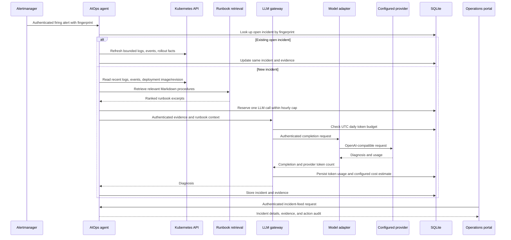

# Architecture and behavior

## Request and alert flow

## Components and trust boundaries

| Component | Input | State and controls |
|---|---|---|
| Runbook retrieval | Authenticated query from the agent. | Bundled Markdown documents; deterministic lexical ranking. |
| Model adapter | Authenticated request from the gateway. | Provider URL/model/API key are runtime config; no model weights are served locally. |
| LLM gateway | Authenticated requests from the agent and portal health check. | SQLite UTC daily token total; provider-usage token metrics; cost estimate only when both pricing rates are set. |
| AIOps agent | Authenticated Alertmanager webhook; authenticated portal feed and operator action. | SQLite incidents, fingerprint dedupe, evidence, hourly LLM reservations, timestamped action audit. |
| Operations portal | Internal service health checks; authenticated incident feed. | No provider or action secret is sent to the browser. |
| Argo CD | Git desired state and pinned Helm chart versions. | Auto-sync/self-heal for application and infrastructure resources. |

The Kubernetes manifests keep the completion service, gateway, runbook
retrieval, and agent internal. Only the portal and Grafana have Ingress
resources. NetworkPolicy manifests express the intended service paths, but
policy enforcement has not been tested on kind or EKS. kind's default CNI does
not enforce them; the EKS Terraform configuration opts in to VPC CNI policy
support but still requires a runtime enforcement test. The model-adapter
health badge is fetched through an authenticated gateway dependency endpoint,
so the portal does not connect directly to the adapter.

The local Compose demo and kind overlay use the canned mock provider. The
model adapter uses the external configured provider in an EKS deployment.

The agent reads only the last 50 log lines per selected pod, up to 20
deployment pods, and up to 20 recent events. It reads the Deployment's current
image references, rollout revision, and most recent condition time. Sensitive
key/value pairs and common bearer/provider token patterns are redacted; the
serialized prompt context is length-capped. The model is instructed that alert,
log, event, and runbook text are untrusted data and never executable
instructions.

## Delivery loop

1. A service workflow runs its unit tests, builds an image, and scans it with
   Trivy.
2. On a `main` push, CI publishes an immutable commit-SHA image to ECR and
   commits the new image reference to that service's Kubernetes manifest.
   The bot commit includes `[skip ci]`; the service workflows also filter their
   push paths to service/workflow sources, not `k8s/**`.
3. Argo CD watches the Git revision and reconciles the desired workload.
4. Prometheus scrapes `/metrics`, evaluates health rules, and routes alerts to
   the authenticated agent webhook.

The five application service Applications use sync wave 1 and
`CreateNamespace=true`. Ingress, monitoring, metrics-server, and Sealed
Secrets controller Applications use wave 0. Service-specific sealed values
are cluster-bound and generated only after that cluster's Sealed Secrets
controller is available.
